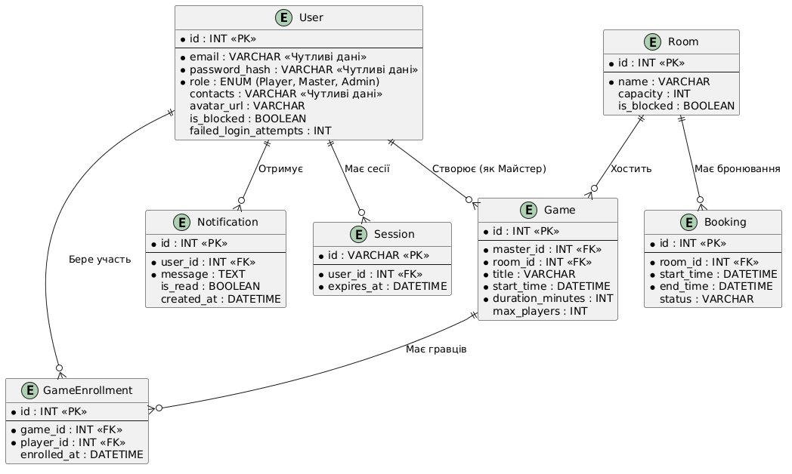

# Модель даних (ER-модель)

## Опис сутностей та кардинальність
Модель даних розроблена для підтримки ключових функцій системи: реєстрації, бронювання кімнат, створення ігор, запису гравців та керування сесіями.

1. **User (Користувач)**: Зберігає дані власників, майстрів та гравців. 
2. **Token (Сесія/Токен)**: Зберігає активні сесії доступу для Користувачів.
3. **Room (Кімната)**: Фізичні приміщення клубу.
4. **RoomBlock (Блокування Кімнати)**: Записи про недоступність кімнат на певні періоди часу.
5. **Game (Гра)**: Подія, створена Майстром, прив'язана до конкретної Кімнати та Часу.
6. **Enrollment (Запис на гру)**: Зв'язуюча таблиця (Many-to-Many) між Користувачами (гравцями) та Іграми.
7. **Notification (Сповіщення)**: Системні повідомлення для Користувачів (наприклад, про скасування гри).

## Чутливі дані (Sensitive Data)
Відповідно до вимог безпеки, наступні атрибути є чутливими і вимагають особливого захисту:
* `User.password_hash` – суворо конфіденційні дані (хеш пароля).
* `User.email` – персональні дані користувача.
* `User.contacts` – персональні контакти гравця, доступні лише йому та власнику клубу.
* `Token.id` – токени доступу (повинні передаватися лише захищеними каналами).

## Ключові функції системи
Модель даних розроблена для забезпечення наступних ключових функцій: реєстрація та управління користувачами (включно з блокуванням), автентифікація через сесії, створення та пошук ігор, запис гравців, управління кімнатами та їх бронюванням, а також розсилка сповіщень.

## ER-діаграма (PlantUML)
Діаграма відображає зв'язки типу "Один-до-Багатьох" (Майстер -> Ігри, Кімната -> Ігри, Користувач -> Токени, Користувач -> Сповіщення) та "Багато-до-Багатьох" (через таблицю Enrollment).

## Використання ШІ
- Структуру документа оновлено з допомогою ШІ для відображення нових 7 сутностей, створених під час міграції на SQLite.