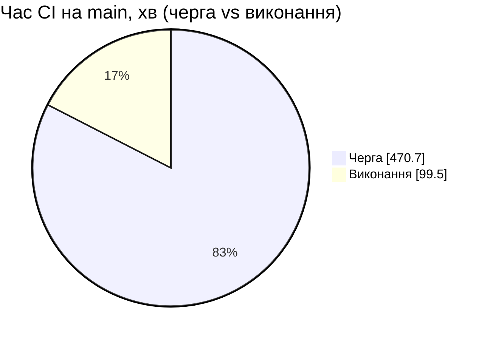
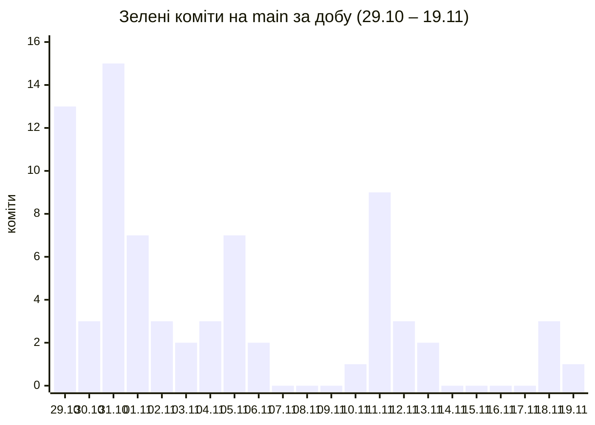

# Підсумок метрик DORA (гілка main, репозиторій vibecoders)

## Дані і визначення

- **Період:** 29.10.2026 – 19.11.2026 (22 доби ≈ 3 тижні), часовий пояс Europe/Kyiv. Сирі дані: `docs/ci-cd/evidence/snapshots/20261118T233201440011Z`, таблиця запусків: [`metrics-raw.md`](metrics-raw.md).
- **Вибірка:** 108 запусків на `main` (107 завершених, 1 незавершений), що дають **74 коміти** (74 різні PR).
- **Враховані workflow:** «CI Pipeline» і «Generate and Deploy API Docs». Коміт зелений, лише якщо зелені всі завершені враховані workflow; docs-workflow запускався на 32 із 74 комітів.
- **Що вважаємо розгортанням:** зелений запуск CI на main (безперервна доставка, Лекція 10 §1.4). Застосунок у production команда не розгортає, тож усі значення є наближенням до визначення DORA.
- **Одиниця підрахунку:** один коміт на main = одне розгортання (не один запуск workflow).
- **Невдала зміна:** червоний запуск на main. Червоні запуски в PR не рахуються.

## Етап 2. Метрики DORA

| Метрика | Формула | Результат | Категорія (DORA 2025: частка опитаних із таким або кращим результатом) |
|---|---|---|---|
| Частота розгортань | зелені коміти на main / тижні | 74 / 3 тижні ≈ **24,7 на тиждень** (≈3,4 на добу; злиття були у 15 із 22 діб) | на вимогу (кілька разів на день) → **16,2%** |
| Час виконання змін | від першого коміту PR до завершення зеленого запуску на main | медіана **56 хв**; середнє **363 хв (≈6 год)**; мінімум 2 хв; максимум 7 205 хв (PR #225, ≈5 діб) | за медіаною: менше години → **9,4%**; за середнім: менше доби → 24,4% |
| Частота збоїв змін | червоні запуски на main / усі завершені запуски на main × 100% | 0 / 107 = **0%** | 0–2% → **8,5%** |
| Час відновлення після невдалого розгортання | від червоного запуску на main до наступного зеленого | **н/д**: червоних запусків на main не було | н/д |

Середнє в часі виконання змін зсунуте двома викидами (PR #225 і PR #164, 2 739 хв), тому основним показником беремо **медіану**. 38 змін із 74 дійшли до main менш ніж за годину, 72 із 74 менш ніж за добу.

### Орієнтири CircleCI

| Показник | Орієнтир | Фактичне значення |
|---|---|---|
| Частка успішних запусків на основній гілці | 90% | **100%** (107/107) |
| Повернення основної гілки до зеленого стану | до 60 хв | н/д (збоїв на main не було) |
| Тривалість запуску workflow | до 10 хв | медіана виконання **1,3 хв**; разом із чергою медіана 1,5 хв, середнє 7,7 хв; понад 10 хв (з чергою) були 5 комітів із 74 |

### Черга і виконання

Розподіл за 74 комітами, критичний (найпізніший) workflow кожного коміту:

| Вимір | Сума, хв | Частка від черги + виконання | Середнє, хв/коміт | Медіана, хв/коміт |
|---|---:|---:|---:|---:|
| Черга | 470,7 | **82,6%** | 6,4 | 0,1 |
| Виконання | 99,5 | **17,4%** | 1,3 | 1,3 |

- Типовий запуск майже не чекає (медіана черги 0,1 хв), але **5 комітів стояли в черзі від 16 до 150 хв**, а разом це 419 із 471 хв (89% усієї черги): #191 (150 хв), #190 (84 хв), #192 (82 хв) увечері 01.11 – уночі 02.11, #165 (88 хв) 30.10 і #187 (16 хв) 01.11.
- **Але в часі виконання змін частка черги мала.** Сумарний час виконання змін усіх 74 PR становить 26 845 хв, із них черга лише ≈1,8%, а черга з виконанням разом ≈2,1%. Решту часу (≈98%) зміна чекає не на CI, а **до злиття**: на рецензію, на виправлення зауважень, на рішення про злиття (PR #225 — 5 діб, PR #200 — ніч, PR #221 — 9,5 год).



## Дашборд: кількість злиттів у main за добу

Нуль означає добу без жодного злиття (07–09.11 і 14–17.11 — пауза).



## Аналіз парами

**Швидкість разом зі стабільністю.**

- Ми розгортаємо часто (≈25 на тиждень) і **без жодного збою на main** (0%): швидкість не куплена ціною стабільності. Це відповідає найкращим рівням DORA за частотою й збоями, хоч за часом виконання змін ми лише в категорії «менше години» за медіаною.
- Нульова частка збоїв на main не означає, що дефектів не було. **28 із 187 запусків у PR (15,0%) були червоними**: дефекти зупинено до злиття (формат Black — 10, `check_traceability.py` — 9, pytest — 4, flake8 — 4, покриття — 1). Тобто перевірки в PR працюють як фільтр, а main залишається зеленою. Чи блокує репозиторій пряме надсилання в main, ми не перевіряли.
- **Частота розгортань і час виконання змін:** розгортань багато, але вони нерівномірні (по 13 і 15 злиттів 29.10 і 31.10, потім паузи по 3–4 доби). Тобто швидкість є, але вона «пачками», а не безперервно.
- **Час виконання змін і збої:** CI сам швидкий (виконання ≈1,3 хв) і стабільний, але зміна чекає до злиття в середньому 6 год. Вузьке місце процесу не в конвеєрі, а в очікуванні рецензії й злиття.
- **Час відновлення** виміряти не вдалося, бо збоїв на main не було. Це не доказ, що ми вміємо відновлюватись, тож у плані нижче є дія зафіксувати правило відновлення заздалегідь.

## Етап 3. Першопричини

### Огляд інциденту (blameless postmortem)

Червоних запусків на main немає, тому оглядаємо 28 червоних запусків у PR за групами причин (повний список із номерами запусків — у [`metrics-raw.md`](metrics-raw.md)):

| Причина | Запусків | Який дефект пройшов непоміченим | Яку перевірку додати |
|---|---:|---|---|
| Black: файл не відформатовано | 10 | форматування не перевірено локально перед пушем | pre-commit хук `black`; перевірка форматування в редакторі |
| `check_traceability.py` | 9 | зміна документації/коду без оновлення трасування вимог | локальний запуск скрипта перед пушем (pre-commit або `make check`) |
| Pytest | 4 | `test_notification` (двічі, 404 замість 200), `test_web`, `test_store` (хеш пароля) | запуск модульних тестів локально; тест хешу залежить від середовища, перевірити |
| flake8 | 4 | стилістична помилка | pre-commit хук `flake8` |
| Покриття (fail-under=95) | 1 | нова гілка коду без тестів (85%) | звіт покриття в PR до рецензії |

Повторні запуски того самого коміту, що стали зеленими без зміни коду, відсутні (`attempt` = 1 для всіх запусків на main), тож ознак нестабільних тестів немає. Один і той самий тест `test_notification` падав у двох різних гілках, ймовірно, через справжній дефект, а не через нестабільність.

### Технічні
- Черга на спільні раннери в окремі вечори (30.10, 01–02.11): 5 комітів дали 89% усього часу черги.
- `ci.yml` запускається і на `push` у `feature/*`, і на `pull_request`, тобто одна зміна може займати раннер двічі. Немає `concurrency` з `cancel-in-progress`, тож застарілі запуски PR не скасовуються.
- 19 із 28 червоних запусків у PR (68%) спричинили Black і трасування, тобто дрібні перевірки, які можна виконати до пушу.
- Docs-workflow запускається на 32 із 74 комітів.

### Організаційні
- Нерівномірні злиття: пікові доби (29.10: 13, 31.10: 15, 11.11: 9) і паузи по 3–4 доби.
- Довге очікування між першим комітом PR і злиттям: медіана 56 хв, але 19 PR із 74 чекали понад 4 год, а PR #225 — 5 діб. Немає домовленості про термін рецензії.
- Чергові злиття наприкінці доби (#191, #192, #200, #221) збігаються з піками черги й нічним очікуванням.
- Немає домовленості, хто і за який час відновлює main, якщо вона зламається.

## План покращень (Improvement Backlog)

| Метрика | Проблема | Першопричина | Дія | Відповідальний |
|---|---|---|---|---|
| Час виконання змін | середнє 6 год, 19 PR із 74 чекали понад 4 год, PR #225 — 5 діб | немає терміну на рецензію; PR відкривають увечері | домовитися про рецензію PR протягом робочого дня (≤ 4 год); дрібні PR; не залишати відкритий PR на ніч | @katespys2006 |
| Час виконання змін | 5 комітів стояли в черзі 16–150 хв | спільні раннери перед дедлайном, застарілі запуски не скасовуються | додати `concurrency` з `cancel-in-progress: true` для PR; не запускати CI двічі (push у `feature/*` і PR); зливати рівномірно впродовж тижня | @katespys2006 |
| Частота розгортань | 15 і 13 злиттів за добу, потім паузи по 3–4 доби | великі нечасті злиття | менші PR; мета: хоча б одне злиття на робочий день | @Sonafi3 |
| Частота збоїв змін | 0% на main, але 28 червоних запусків у PR (15%) | дрібні дефекти (Black, трасування, flake8) виявляються лише в CI | `pre-commit` із `black`, `flake8` і `check_traceability.py`; перевірити в налаштуваннях, що main захищена від прямих пушів | @iraholdynska |
| Частота збоїв змін | надійність перевірок на main не підтверджена | на main лише ті самі перевірки, що й у PR | швидкий набір на PR, повільний (інтеграційний із реальною залежністю) після злиття в main (§2.3.6) | @iraholdynska |
| Час відновлення | не виміряно: збоїв на main не було | не визначено порядок дій при червоній main | записати правило: червона main → відкат (revert) або виправлення протягом 60 хв, відповідальний чергує тиждень | @iraholdynska |

**Ключовий висновок:** ми зливаємо в main майже щодня (≈25 на тиждень) і без жодного збою (0%), але CI тут не вузьке місце: черга займає лише ≈2% часу виконання змін, а ≈98% зміна чекає на рецензію і злиття до CI.

**Дія до наступного тижня:** домовитися про термін рецензії PR (≤ 4 год у робочий день) і додати `concurrency` з `cancel-in-progress` для запусків PR.

## Який біль у нашій команді показали ці метрики?

- **Біль очікування, а не збірки.** Конвеєр швидкий (1,3 хв), але PR днями й ночами чекають, поки їх перегляне й зіллє хтось із команди. Код, написаний у п'ятницю 13.11, потрапив у main лише в середу 18.11 (#225). Це класичний біль часу виконання змін: втрата зосередженості й «забуті» pull request.
- **Біль «пачками».** Команда зливає 13–15 змін за добу, а потім 3–4 доби нічого. Великі пачки перед дедлайнами створюють черги на спільні раннери (до 2,5 год) і ризик для всіх, хто залежить від main.
- **Біль дрібних помилок.** Кожен сьомий запуск у PR червоний, і дві третини з них спричинені форматуванням та трасуванням, тобто тим, що можна виявити за секунди локально. Команда витрачає час на цикл «пуш → чекати → червоний → виправити → пуш».
- **Незвіданий біль відновлення.** Main жодного разу не ламалась, тому ми не знаємо, як швидко відновимося. Без домовленостей, хто лагодить, перший збій може зупинити всю команду.
- Метрики описують процес, а не людей: ніхто не винен у черзі чи довгій рецензії, це наслідок домовленостей (або їх відсутності).

## Бонуси

### Автоматичний підрахунок метрик

- Скрипт: `scripts/dora_metrics.py` (тести: `src/api/tests/test_dora_metrics.py`).
- Команда запуску (з кореня репозиторію, потрібен `gh auth login`):

```sh
python scripts/dora_metrics.py --since 2026-10-29 --until 2026-11-19 --export-json docs/ci-cd/evidence/runs-main.json
```

- Результат: [`dora-auto.md`](dora-auto.md) і `evidence/runs-main.json`.
- Скрипт запущено 19.11.2026 об 11:00 (UTC+2), результат — [`dora-auto.md`](dora-auto.md): 78 зелених запусків «CI Pipeline» на main, 0 червоних, `attempt` = 1 для всіх.

| Показник | Ручний підрахунок (цей файл) | Скрипт (`dora-auto.md`) | Пояснення |
|---|---|---|---|
| Кількість комітів | 74 коміти (107 запусків двох workflow) | 78 зелених запусків CI | Скрипт запущено пізніше за зріз ручних даних (19.11 01:32): додано 4 коміти #229, #231, #232, #233, злиті вранці 19.11. Решта 74 коміти збігаються поштучно. |
| Частота розгортань | 24,7 / тиждень (74 / 3 тиж.) | 24,8 / тиждень (78 / 3,1 тиж.) | Різні кількість комітів і тривалість періоду (скрипт рахує до моменту запуску); висновок той самий: «на вимогу», 16,2%. |
| Час виконання змін | медіана 56,4 хв; середнє 362,8 хв | медіана 61,7 хв; середнє 385,4 хв | Ті самі 74 коміти за скриптом дають медіану 56,4 хв і середнє 361,8 хв, тобто різниця в основному від 4 нових комітів (зокрема #229: 2 377 хв). Залишок 1 хв у середньому пояснюється п. «Черга» нижче. |
| Частка черги (черга / виконання у часі CI) | 82,6% / 17,4% | 78,3% / 21,7% | Скрипт бере чергу й виконання лише від workflow `ci.yml`, ручна таблиця бере найпізніший із двох workflow коміту. У 6 комітів (#165, #187, #180, #170–#172) docs-workflow завершився пізніше й чекав у черзі довше (напр., #165: 87,5 хв проти 27,7 хв). |
| Частка черги в часі виконання змін | ≈1,8% | 1,3% | Те саме пояснення; висновок однаковий: ≈98% часу — до запуску CI (рецензія, очікування злиття). |
| Частота збоїв / відновлення | 0% / н/д | 0,0% / н/д | Збігається. |

**Висновок зі звірки:** різниця між підрахунками має три причини: зріз даних (+4 коміти), набір workflow (скрипт без docs-workflow) і довжина періоду. На однакових 74 комітах медіана часу виконання змін збігається (56,35 хв), а різниця в середньому (≈1 хв) і в частці черги (79,4% проти 82,6%) зумовлена docs-workflow. Усі висновки аналізу парами не змінюються.

> **Увага до категорії:** медіана часу виконання змін лежить біля межі в 1 годину: 56,4 хв (74 коміти) дає категорію «менше години» (9,4% опитаних), а 61,7 хв (78 комітів, зі скриптом) уже «менше доби» (24,4%). Тому в основній таблиці це значення названо наближенням; надійного висновку про межу «година» дані не дозволяють.

### Пошук нестабільних тестів

- Workflow: `.github/workflows/flaky-tests.yml` (запускається лише вручну, 5 повторів повного набору в одному завданні); звіт: `scripts/flaky_report.py`.
- Запуск workflow: [flaky-tests, run 44493387330](https://github.com/ukma-fin-ssdm-2026/vibecoders/actions/runs/44493387330) (5 повних повторів набору на `main`).
- Тести з різним результатом між повторами: **не виявлено**: 425 унікальних тестів у 5 повторах, жодних нестабільних і жодних стабільних збоїв (виведення `python scripts/flaky_report.py reports`).
- Повторні запуски на main за період Етапу 1 (`attempt > 1`), що стали зеленими без зміни коду: **немає**: усі 107 завершених запусків мали `attempt = 1`.
- Якщо нестабільний тест знайдено, його виправлено або винесено в карантин з issue: не застосовується, бо нестабільних тестів не виявлено.

### Інші бонуси команди

- Покращення з виміряним ефектом (кеш pip): [`bonus-improvement.md`](bonus-improvement.md). У трьох виміряних запусках повна тривалість jobs не скоротилася: із холодним запуском вона вища за базу на 10,0% (`validate-and-test`) і 12,6% (`reliability-tests`); лише на двох теплих — на 9,5% і 9,9%. Крок встановлення залежностей скоротився, але PR #233 також змінив його спосіб для reliability job, тому ефект не можна приписати лише кешу.
- Артефакт випуску (образ у ghcr.io): [`bonus-release-artifact.md`](bonus-release-artifact.md). Після виправлення умови в PR #239 job `publish-container` успішно завершився у [CI run 44510454012](https://github.com/ukma-fin-ssdm-2026/vibecoders/actions/runs/44510454012) ([job](https://github.com/ukma-fin-ssdm-2026/vibecoders/actions/runs/44510454012/job/135513897895)). Опубліковано образ із SHA-тегом `f03eb2b97b08163c499dba64d7e3124f52110571` на [сторінці пакета vibecoders у GitHub Packages](https://github.com/ukma-fin-ssdm-2026/vibecoders/pkgs/container/vibecoders), приватного й видимого в межах організації.

#### DORA-метрики для публікації контейнера

Порівняння основних DORA-метрик із вимірами для публікації контейнера:

| Метрика | Основне визначення (CI на `main`) | Публікація `publish-container` |
|---|---|---|
| Частота розгортань | 74 зелені коміти за 3 тижні ≈ **24,7 на тиждень** | Після merge PR #239: **1** успішна публікація за періодом спостереження 19.11.2026 10:57:45–11:17:15Z (**19 хв 30 с**; 1/19 хв 30 с). Це дуже коротке вікно й одне спостереження, тому тижневу частоту не екстраполюємо. |
| Час виконання змін до розгортання | медіана **56 хв**, середнє **363 хв** | Для єдиної успішної публікації PR #239: **6 хв 37 с** від authoredDate першого коміту PR (10:54:17Z) до завершення публікації (11:00:54Z). Одне спостереження: середнє й медіана дорівнюють 6 хв 37 с, але не є репрезентативною вибіркою. |
| Частота збоїв | **0/107 = 0%** червоних запусків на `main` | **0/1 = 0%** невдалих публікацій серед усіх спроб після PR #239: у єдиному запуску `main` job `publish-container` був успішним. |

Після merge PR #239 (19.11.2026 10:57:45Z) до зрізу о 11:17:15Z у `gh run list --workflow ci.yml --branch main` є один запуск — [44510454012](https://github.com/ukma-fin-ssdm-2026/vibecoders/actions/runs/44510454012), із завершенням `publish-container` о 11:00:54Z. Отже, у єдиному спостереженому запуску є одна успішна публікація й нуль невдалих; попередні `skipped` job були до виправлення та не входять у цей підрахунок. Це надто мала вибірка для висновку про довгострокову частоту розгортань або збоїв.

## Обмеження

- Метрики є наближенням: розгортанням вважається зелений запуск CI, а не розгортання в production.
- Час виконання змін обчислено за комітами злитих PR; для PR із кількома комітами береться перший. Старт відліку — `authoredDate` першого коміту, який міг бути створений задовго до відкриття PR.
- Час відновлення не виміряно, бо на main не було жодного червоного запуску; 100% успіху не доводить сили перевірок, а може свідчити про те, що дефекти зупиняє PR.
- Ручна таблиця зафіксована на 19.11.2026 01:32, а запуск скрипта пізніший (+4 коміти); див. розділ «Бонуси». Дані за короткий період із піками 29–31.10 і 01–02.11, тож показники не обов'язково типові для звичайного тижня.