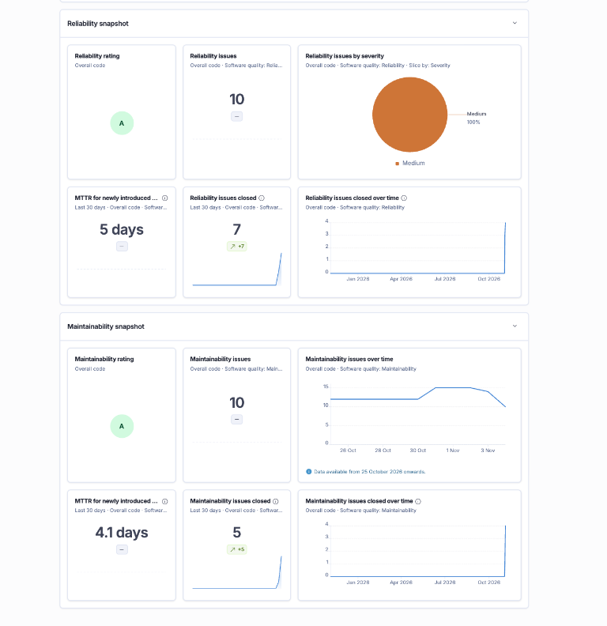
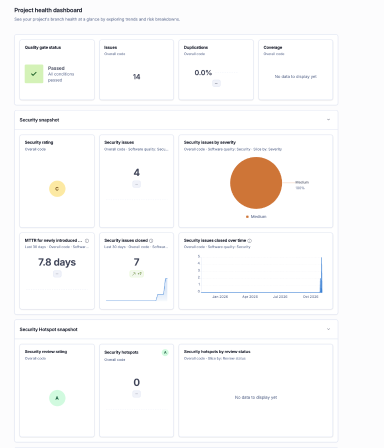
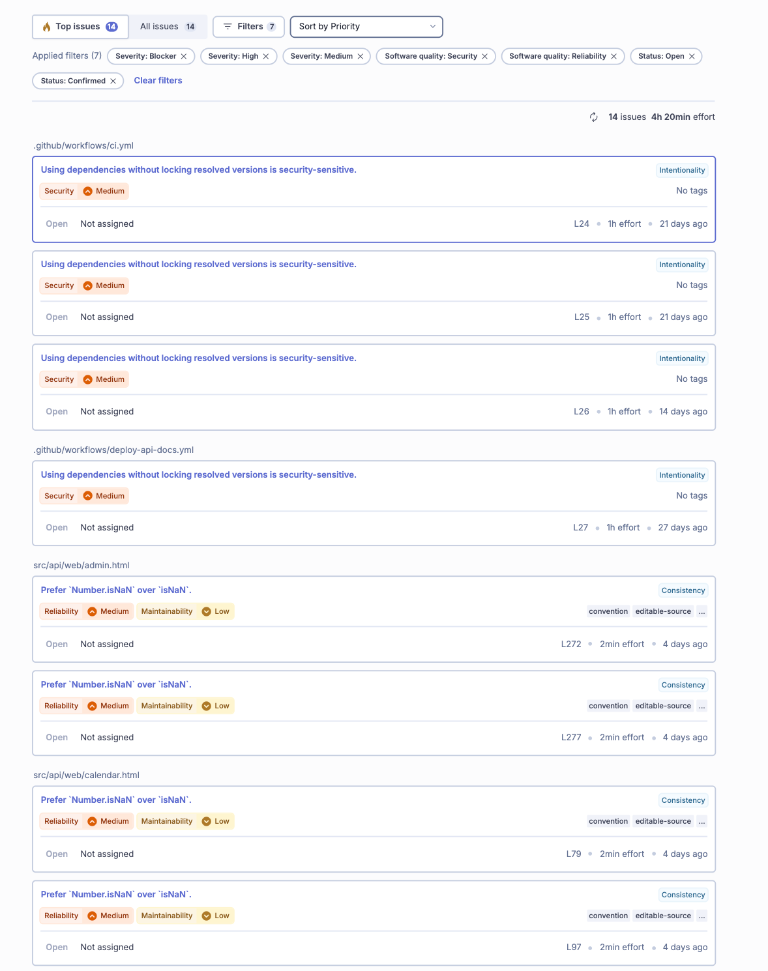
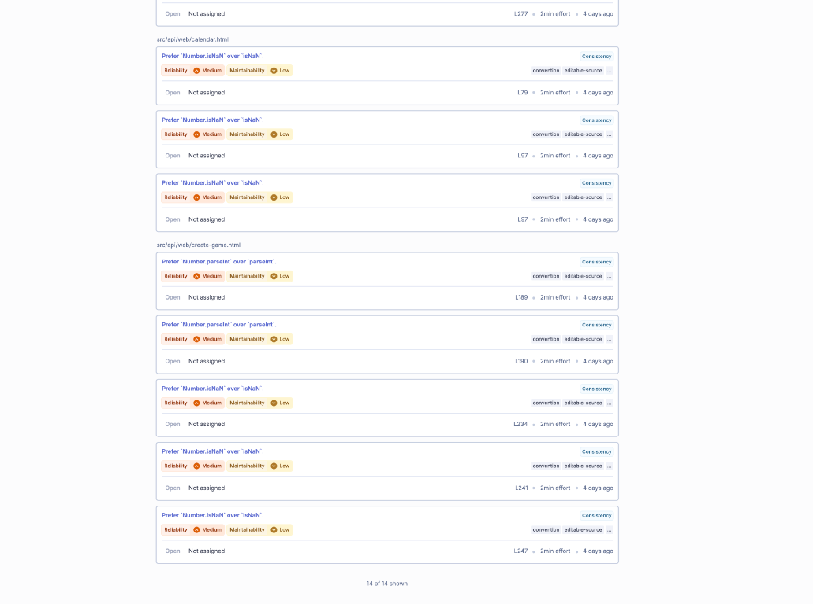
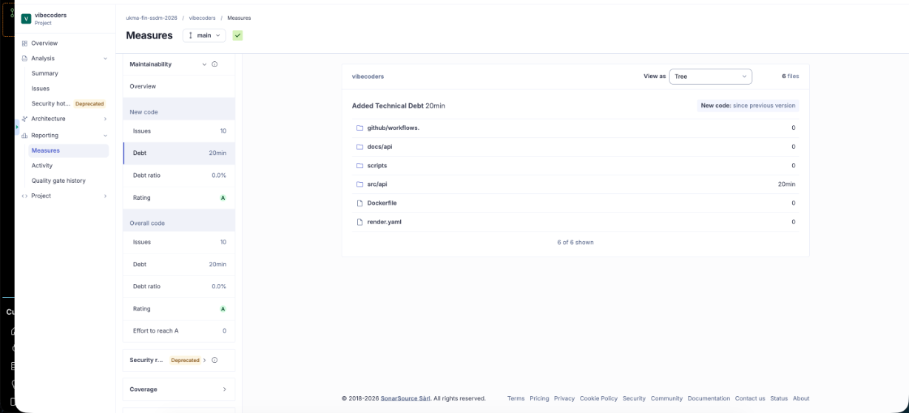
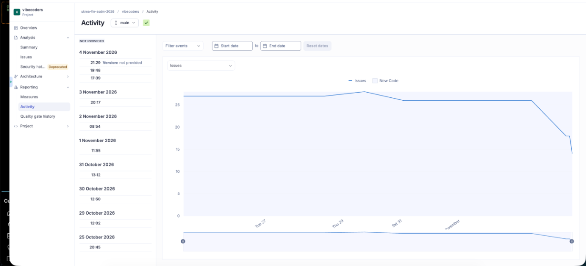
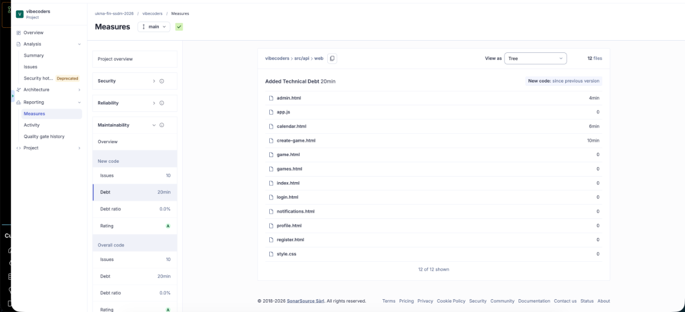

# SonarQube Cloud Analysis Report

**Команда:** vibecoders

---

## 1. Метрики «до»

- **Дата аналізу:** 03.11.2026, commit `bdd8e9f4b9cf09812c03e3e46d3209a4eb1a4aca` (до PR #196)
- **Обсяг:** ≈ 9,7 тис. рядків коду
- **Quality Gate:** Passed
- **Всього зауважень на панелі:** 26

| Показник | Значення «до» | Деталі |
| :--- | :---: | :--- |
| **Security Rating** | **C** | 9 Security issues (≈11% High, ≈89% Medium) |
| **Reliability Rating** | **C** | 17 Reliability issues (≈6% High, ≈94% Medium) |
| **Maintainability Rating** | **A** | 16 Maintainability issues (Code Smells) |
| **Code Smells** | **16** | відповідає Maintainability issues |
| **Technical Debt** | **35 хв** | Значення з відгуку викладача для baseline commit |
| **Duplicated Lines (%)** | **0,0%** | - |

> Одне зауваження може впливати на кілька якостей (Security, Reliability, Maintainability), тому 9 + 17 + 16 більше за 26.

Історичний baseline відповідає коміту `bdd8e9f`, а не гілці `main` після PR #199. Значення 35 хв і 16 Code Smells взяті з відгуку викладача; SonarCloud Web API наразі не повертає збережений аналіз для цього commit.

Скриншоти «до»: 

---

## 2. Обрані метрики для покращення (3 показники)

1. **Reliability Rating (C, 17 issues)**
   * Рейтинг C вказує на проблеми, що впливають на стабільність виконання. 14 з 17 зауважень: глобальні `isNaN()` і `parseInt()` замість `Number.isNaN()` і `Number.parseInt()` у клієнтському JS; ще `lang` у `index.html`, порожній заголовок у `game.html` і `[` у `run_mutation.sh`.
2. **Code Smells (16 issues, Maintainability A)**
   * Рейтинг уже A, але 16 зауважень є технічним боргом. Мета: зменшити кількість Code Smells (16 зауважень, 35 хв боргу).
3. **Technical Debt (35 хв)**
   * Мета: зменшити сумарний час усунення зауважень. Нотатка: Maintainability Rating уже A, тому його рівень піднімати нема куди; покращення вимірюємо в хвилинах боргу.

### Проміжний аналіз після PR #196, до рефакторингу `app.js`

SonarCloud Web API містить аналіз commit `47aa3b38cc504b3604ec20e491c6824958f02258` від 04.11.2026 15:39:19 UTC: Technical Debt — 28 хв, Code Smells — 14. Це проміжний стан після PR #196, а не baseline до нього і не фінальний стан після PR #199.

---

## 3. Security Rating 

* **Security Rating «до»:** **C** (9 issues: 1 High, 8 Medium). Усі 9 знахідок лежать у CI-конфігурації, у Python-коді `src/api` Security-зауважень немає.

| # | Правило | Файл, рядок | Severity | Що робимо |
| :-: | :--- | :--- | :---: | :--- |
| 1 | `Use full commit SHA hash for this dependency` (supply chain, former hotspot) | `deploy-api-docs.yml` L34 (`peaceiris/actions-gh-pages@v4`) | High | Закріпити action за повним 40-символьним SHA коміту |
| 2 | `Omitting "--only-binary :all:" can lead to the execution of setup scripts` | `ci.yml` L24, L25, L26; `deploy-api-docs.yml` L27 | Medium (×4) | Додати `--only-binary :all:` до `pip install`; перевірити, що всі пакети мають wheel |
| 3 | `Using dependencies without locking resolved versions is security-sensitive` | `ci.yml` L24, L25, L26; `deploy-api-docs.yml` L27 | Medium (×4) | Зафіксувати версії: `pip==...`, `black/flake8/bandit/pytest` з `==`, залежності з `requirements.txt` перевести на точні версії (за можливості з `--require-hashes`) |

Рядки `ci.yml`: L24 `pip install --upgrade pip`, L25 `pip install -r src/api/requirements.txt`, L26 `pip install black flake8 bandit pytest pytest-cov`. `deploy-api-docs.yml` L27: `pip install -r requirements.txt`.

### 3.1. Зв'язок знахідок із `static-analysis.md` (Лаб 5) і `threat-model.md` (Лаб 3)

**Зв'язок із `threat-model.md` (STRIDE).** Усі 9 знахідок стосуються ланцюга постачання в CI/CD (GitHub Actions, PyPI). У моделі загроз такого компонента немає: вона описує лише межі TB1 (Інтернет ↔ FastAPI), TB2 (FastAPI ↔ SQLite) і TB3 (FastAPI ↔ SMTP). Тож Sonar виявив прогалину моделі, а не ризик, який там уже враховано.

| Знахідка Sonar | Категорія STRIDE | Яка загроза | Зв'язок із `threat-model.md` | Контрзахід |
| :--- | :--- | :--- | :--- | :--- |
| `peaceiris/actions-gh-pages@v4` без SHA (`deploy-api-docs.yml` L34), High | **Tampering** (зламаний action або підмінений тег виконає шкідливий код); **Elevation of Privilege** (workflow має `contents: write` і передає action `GITHUB_TOKEN`) | Зловмисник отримує право запису в репозиторій і публікацію на GitHub Pages | Не покрито. Найближчі рядки таблиці: Tampering і Elevation of Privilege, але лише для TB1 | Закріпити action за повним SHA |
| Немає `--only-binary :all:` (`ci.yml` L24–26, `deploy-api-docs.yml` L27), Medium ×4 | **Tampering** | Під час `pip install` може виконатися `setup.py` шкідливого пакета на CI-раннері | Не покрито | `--only-binary :all:` |
| Незафіксовані версії залежностей (ті самі рядки), Medium ×4 | **Tampering** | Нова (або підмінена) версія пакета потрапляє в збірку без перевірки | Не покрито | Точні версії, за можливості `--require-hashes` |

Висновок для моделі загроз: додати межу **TB4 (GitHub Actions ↔ зовнішні action та PyPI)** і рядок Tampering/Elevation of Privilege із цим контрзаходом. Це можна записати як окремий рядок у `threat-model.md` разом із PR рефакторингу.

**Зв'язок зі `static-analysis.md`.**
- Bandit (розділ 2.3) повідомляє 0 зауважень, і це не суперечить Sonar: Bandit сканує лише Python у `src/api` (2020 рядків, 17 файлів), а 9 Security-знахідок Sonar лежать у `.github/workflows/*.yml`, які Bandit не перевіряє. Два інструменти доповнюють один одного.
- Знахідку Sonar про передбачувану сіль у `store.py`, зафіксовану в попередньому аналізі, закрито ще в Лаб 5: `PASSWORD_SALT` тепер береться зі змінної середовища (розділ 4 і розділ 6 `static-analysis.md`, хук `detect-secrets`). У поточних 26 issues її немає.
- Ризики, які `static-analysis.md` (розділ 4) прийняв свідомо, Sonar зараз не показує: демо-токени (`master-token` та ін.) і демо-паролі в `seed.py` і `web/login.html`, а також значення солі за замовчуванням `default-insecure-salt-for-dev` у `store.py`. Вони не впливають на Security Rating, але лишаються відкритими для реального розгортання.
- `static-analysis.md` розділ 2.3 згадує, що Docker-образ запускається з `--host 0.0.0.0`; Dockerfile Bandit не сканує, тож це теж варто мати на увазі як окрему поверхню.

**Security Rating до/після рефакторингу.**

| Показник | До | Після |
| :--- | :---: | :---: |
| Security Rating | C | C |
| Security issues | 9 (1 High, 8 Medium) | 4 (усі Medium) |

---

## 4. Reliability: ключові знахідки (17 issues)

| Група | К-сть | Файли | Що робимо |
| :--- | :-: | :--- | :--- |
| `Prefer Number.isNaN over isNaN` (Medium Reliability + Low Maintainability) | 10 | `admin.html` L272, L277; `app.js` L86, L104; `calendar.html` L79, L97 (×2); `create-game.html` L234, L241, L247 | Замінити на `Number.isNaN` |
| `Prefer Number.parseInt over parseInt` (Medium Reliability + Low Maintainability) | 4 | `app.js` L105, L208; `create-game.html` L189, L190 | Замінити на `Number.parseInt` |
| `lang` у `<html>` (WCAG A) | 1 | `docs/api/index.html` L2 | Додати `lang="en"`; файл статичний, не генерується |
| Порожній заголовок для screen reader | 1 | `game.html` (`<h1 id="game-title">`) | Додати запасний текст у заголовок до завантаження JS |
| `[` замість `[[` (High Reliability) | 1 | `scripts/run_mutation.sh` L10 | Замінити на `[[ ... ]]` |

Примітка про `isNaN` і `parseInt`: глобальний `isNaN("abc")` приводить аргумент до числа, а `Number.isNaN` ні. Тож заміна може змінити поведінку, якщо код передає рядки. Перед масовою заміною перевірити виклики на тип аргумента (це важливо для умови «рефакторинг не змінює поведінку»).

## 5. Maintainability і Technical Debt

| Стан | Commit | Code Smells | Technical Debt |
| :--- | :--- | ---: | ---: |
| Baseline до PR #196 | `bdd8e9f4b9cf09812c03e3e46d3209a4eb1a4aca` | 16 | 35 хв |
| Після PR #196, до рефакторингу `app.js` | `47aa3b38cc504b3604ec20e491c6824958f02258` | 14 | 28 хв |
| Після PR #199 | `d7e8439ed25417d8674e7147442a6fbe5dded127` | 10 | 20 хв |

Це послідовні SonarCloud snapshots, а не окремий причинний вимір внеску кожної зміни. Baseline 35 хв для commit `bdd8e9f` надано у відгуку викладача; значення 28 хв і 14 Code Smells підтверджено Web API для commit `47aa3b`; фінальні 20 хв і 10 Code Smells — для `d7e8439`.

---

## 6. Метрики «після»

| Показник | До | Після |
| :--- | :---: | :---: |
| Reliability Rating | C (17 issues) | A (10 issues) |
| Code Smells | 16 | 10 |
| Technical Debt | 35 хв | 20 хв |
| Security Rating | C (9 issues: 1 High, 8 Medium) | C (4 issues, усі Medium) |
| Duplicated Lines (%) | 0,0% | 0,0% |

**Інші дані після аналізу:** Maintainability Rating — A (10 issues); Quality Gate — Passed; усього issues — 14. SonarCloud не показував даних про coverage.

Джерело фінальних метрик: SonarCloud для гілки `main`. Web API підтверджує, що аналіз із Technical Debt 20 хв і 10 Code Smells відповідає commit `d7e8439ed25417d8674e7147442a6fbe5dded127` (merge PR #200), дата аналізу — 05.11.2026 08:11:13 UTC. Цей стан містить зміни PR #199. Попередній аналіз на `eeb1c0365065b460129d65df2559ef3c4d04078f` — це merge PR #199, але в наявній історії SonarCloud для нього немає окремого snapshot.

Скриншоти «після» (SonarCloud, гілка `main`; знімки надані 04.11.2026, commit аналізу уточнено через Web API вище):

## 7. Рефакторинги й регресійне тестування

### Characterization-тест до рефакторингу (не заявляється як бонус)

До PR #199 додано тест для `src/api/generate_openapi.py`, який фіксує поведінку CLI: скрипт викликає `save_openapi_spec(app)` під час запуску як `__main__`, але не під час імпорту. Оскільки сам `generate_openapi.py` не рефакторився, цей тест не заявляється як бонус за characterization-тестування рефактореного модуля.

Тест `test_app_date_and_retry_after_helpers_keep_their_behavior` з PR #199 був доданий у тому самому commit `fb437ba`, що й зміна `app.js`, а не окремим попереднім commit. Його поведінкові твердження були перевірені ретроспективно на старому `app.js` із `fb437ba^` через той самий Node.js harness: отримано `not-a-date`, порожній невалідний слот, `10:00–11:30` і `Retry-After` 30. Це підтверджує збереження цих прикладів поведінки, але не перетворює тест на characterization-тест, доданий до рефакторингу; бонус не заявляємо.

### Рефакторинг і регресійне тестування

У PR #199 у `src/api/web/app.js` застосовано техніку **Substitute Algorithm**: глобальні `isNaN` і `parseInt` замінено на відповідні методи `Number`.

| Запах / проблема | Техніка | Що лишається незмінним | Перевірка |
| :--- | :--- | :--- | :--- |
| Неявні глобальні числові функції в `app.js` | Substitute Algorithm | Невалідна дата повертається як вихідний рядок; невалідний слот лишається порожнім; валідний слот зберігає формат; `Retry-After` далі читається як ціле число | `test_app_date_and_retry_after_helpers_keep_their_behavior` у `src/api/tests/test_web_app_js.py`; тест виконує реальний JS у Node.js |

### Регресійний прогін до і після

Обидва прогони виконано локально на Python 3.13.7 з однаковою командою `pytest src/api/tests --cov=src/api --cov-report=term-missing --cov-fail-under=95`. Baseline — гілка `pre-refactor`, commit `47aa3b38cc504b3604ec20e491c6824958f02258`; стан після змін — `main`, commit `d7e8439ed25417d8674e7147442a6fbe5dded127`.

Гілка `pre-refactor` вказує на commit `47aa3b`, який є нащадком merge commit PR #196 (`348af65`). Тому цей baseline є «до рефакторингу `app.js`» з PR #199, але вже містить попередні remediation-зміни PR #196.

| Стан | Commit | Результат | Coverage |
| :--- | :--- | :--- | :---: |
| До рефакторингу | `47aa3b38cc504b3604ec20e491c6824958f02258` | 293 passed, 1 xfailed | 96.39% |
| Після рефакторингу | `d7e8439ed25417d8674e7147442a6fbe5dded127` | 296 passed, 1 xfailed | 96.39% |

Після змін у SonarCloud залишилися 10 Reliability issues, зокрема рекомендації щодо глобальних `isNaN`/`parseInt` у `admin.html`, `calendar.html` і `create-game.html`, а також 4 Security issues щодо фіксації версій залежностей. Вони не входили до PR #199 і не позначаються тут як виправлені.

### Мутаційна перевірка для відео Лабораторної 6

У актуальному mutation-run після перенесення `store.py` на SQLite проаналізовано 388 мутантів: 322 вбито, 66 вижили (сирий mutation score — 83,0%). Це новий набір мутантів, тому старі результати 68 мутантів / 97,1% не використовуються як показник для поточного коду.

Для демонстрації цільового тесту виконано два прогони однаковим скриптом:

| Запуск | Усього | Вбито | Вижило | `store.x_find_busy_game__mutmut_4` |
| :--- | ---: | ---: | ---: | :--- |
| Без `test_find_busy_game_skips_excluded_game_and_still_finds_later_conflict` | 388 | 321 | 67 | survived |
| З цим тестом | 388 | 322 | 66 | killed |

У мутанті `continue` замінено на `break`. Коли тест прибрано лише в тимчасовій копії, мутант виживає; повернення тесту змушує мутант упасти, бо цикл має пропустити редаговану гру й продовжити пошук наступного конфлікту. Для відео слід показати команди з `docs/testing/testing-strategy.md`, статус цільового мутанта в результатах і тест `test_find_busy_game_skips_excluded_game_and_still_finds_later_conflict`.

Властивість `test_time_overlap_is_symmetric_for_any_slots` у `src/api/tests/test_properties.py` означає, що `time_overlap(A, B) == time_overlap(B, A)` для будь-яких двох згенерованих слотів. Перестановка інтервалів не змінює наявність перетину; межі слотів напіввідкриті, тож послідовні слоти не перетинаються.

### Інші Sonar remediation команди

PR #196 також закрив частину проблем у GitHub Actions, shell-скрипті та доступності HTML: pinning action SHA і CI-інструментів, wheel-only встановлення, `[[` у Bash, атрибут `lang` і текст заголовка. Це командні remediation-зміни, а не окремі рефакторинги `app.js`; після них їхній результат перевірено успішними CI та SonarCloud.

## 8. Бонуси

Бонуси не заявляємо. Тест поведінки `app.js` додано в одному commit із рефакторингом, а історичного PR із зупиненим Quality Gate і подальшим успішним виправленням немає. Автоматизований release workflow також не налаштовували.

## Використання ШІ

За наявним командним звітом, Sonar remediation у PR #196 готували з Claude; characterization-тест у PR #198, рефакторинг і поведінковий тест у PR #199, а оновлення розділів про регресійні тести й реліз у цьому звіті виконано з GitHub Copilot у VS Code. Попередні Security-розділи звіту були підготовлені з Claude. Катерина перевірила зміни, виконала тести й звірила Sonar-метрики з аналізом гілки `main`.

### 1. Документація 
Структуру й формулювання попередніх Security-розділів звіту, зокрема таблиці Security та зв'язку зі `static-analysis.md` і `threat-model.md`, підготували за допомогою Claude. У цьому оновленні регресійні результати й релізні зміни оформлено за допомогою GitHub Copilot у VS Code. Цифри Sonar звірено з панеллю SonarQube Cloud та Web API, а результати тестів — із локальним прогоном.

### 2. Рефакторинг, виконаний із ШІ-агентом
Закрито 8 зауважень Sonar шістьма окремими комітами `[REFACTOR]`:

| № | Запах / зміна | Техніка | Інваріант | Як перевірено |
| :-: | :--- | :--- | :--- | :--- |
| 1 | GitHub Pages action прив'язаний до рухомого tag | Pin dependency to immutable commit | Залишається action v4 і його deploy API; змінюється лише спосіб фіксації джерела | SHA `84c30a85c19949d7eee79c4ff27748b70285e453` записаний з позначкою `v4`; документація успішно опублікована в [run 42907737494](https://github.com/ukma-fin-ssdm-2026/vibecoders/actions/runs/42907737494) |
| 2 | Встановлення docs-залежностей без обмеження на wheel | Restrict installation to binary wheels | Встановлюється той самий `requirements.txt`; джерельні пакети не збираються під час CI | Успішний docs deployment [run 42907737494](https://github.com/ukma-fin-ssdm-2026/vibecoders/actions/runs/42907737494) |
| 3 | CI не вимагав wheel і не фіксував інструменти | Restrict installation to wheels; pin tool versions | Ті самі перевірки Black, Flake8, Bandit і pytest лишаються в CI | `validate-and-test` успішний у [run 41692394488](https://github.com/ukma-fin-ssdm-2026/vibecoders/actions/runs/41692394488) |
| 4 | Перевірка `MUTATION_WITHOUT_TEST` через `[` | Replace test with Bash `[[ ]]` | Порожнє значення лишається false, непорожнє — true; вибір mutant test не змінюється | `bash -n scripts/run_mutation.sh` проходить; mutation-прогони й поведінка цільового тесту описані вище |
| 5 | Немає мови сторінки API docs | Add document language metadata | Текст і навігація сторінки не змінюються | Перевірено HTML-атрибут `<html lang="en">`; CI та SonarCloud для [PR #196](https://github.com/ukma-fin-ssdm-2026/vibecoders/pull/196) пройшли |
| 6 | Порожній `<h1>` до завантаження гри | Add accessible loading fallback | Після завантаження в заголовку відображається назва гри | Перевірено початковий текст і присвоєння `game.title` у `game.html`; окремого UI-тесту для цього placeholder немає |

### 3. Зміна солі пароля в PR #165

PR #165 не був поведінково еквівалентним рефакторингом. У першому коміті `bee4dd1` статичну сіль замінили випадковою, що створювалася під час хешування; у `fd743e0` її перенесли на рівень модуля, щоб хеш був сталим у межах одного процесу. Саме process-scoped випадкова сіль увійшла до злитого стану PR #165 (`ea3c41e`). Після перезапуску процесу сіль змінювалася, тому вже збережені хеші паролів не можна було перевірити.

Пізніший коміт `134ce91` переніс сіль у змінну середовища `PASSWORD_SALT`, але залишив небезпечне значення за замовчуванням `default-insecure-salt-for-dev`. Для стабільної перевірки збережених хешів production-середовище має задавати й зберігати одне й те саме секретне значення між перезапусками. Наявний `test_verify_password_accepts_correct_and_rejects_wrong` перевіряє лише роботу в одному процесі; він не доводить збереження поведінки після перезапуску.

Отже, зміни PR #165 включали security-поведінкову зміну, а не лише техніку *Replace Inline Code with Function Call*. Попереднє твердження про «абсолютне збереження» поведінки було неправильним.
